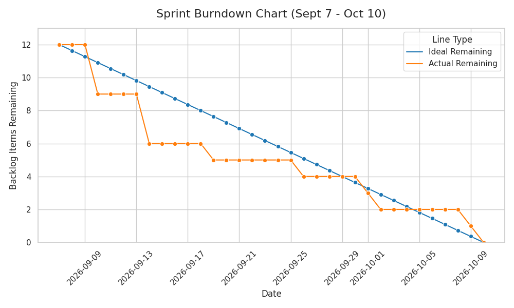

\pagebreak
# 1. Executive Summary & Sprint Goal

**Project:** MQ Sentinel  
**Objective:** Build a proof-of-concept autonomous satellite capable of locating and removing simulated space debris (represented by 38 kHz infrared beacons) using an eye-safe laser pointer. The system must operate fully contained within a 170 mm x 150 mm PVC pipe, utilizing a DC gearmotor reaction wheel for attitude control while suspended from a low-friction swivel. 

**Sprint Goal:** Transition from the V1 proof-of-concept (subsystem integration demonstration) to a fully viable V2 prototype. Execute an impeccable, standard-paced sprint that flawlessly closes the loop on V1 failures (specifically IR signal bounce) using a highly disciplined product backlog and objective tracking methodologies.

# 2. Scrum Team & Roles

To ensure strict backlog discipline and accountability, the team is structured with clear delineations between hardware, software, and Agile management:

| Name | Role | Core Responsibilities |
| :--- | :--- | :--- |
| **Seth** | Product Owner / Hardware | Backlog prioritization, stakeholder alignment, circuit design and wiring, hardware design and component integration . |
| **Gabriel** | Scrum Master / Software | Process enforcement, objective tracking, removing blockers, software implementation, telemetry recording and processing, software architecture. |
| **Harvey** | Software Developer | Software development, input handling, input processing. |
| **Richard** | Software Developer | software development and testing, focused on motor actuation and calibration. |
| **Allan** | Hardware Engineer | Physical structural assembly, 3D printing design and fabrication . |

# 3. Root Cause Mapping: V1 Failures to V2 Solutions

The following table maps the failures experienced during the V1 iteration to the objective corrective actions implemented in the V2 sprint. 

| Failure Category | V1 Observation / Issue | Root Cause | V2 Corrective Action |
| :--- | :--- | :--- | :--- |
| **Hardware / Sensor** | Initial target of two side-mounted IR sensors to drive bidirectional motor movement failed. Both sensors triggered simultaneously. | High ambient IR noise and signal bounce within the testing room caused cross-talk. | **Pivot & Redesign:** Added 3D-printed sheaths/coverings to restrict IR sensor Field of View (FOV) to ~65 degrees. Also sink sensors into main body for a smooth outer body. |
| **Process / QA** | Discovered the IR FOV overlap too late to implement a mechanical fix for the V1 deadline. | Testing of sensor angles and environmental reflection was scheduled too late in the sprint. | **Process Shift:** Objective, isolated hardware validation moved to the very beginning of the sprint backlog (Shift-Left Testing). |
| **Deliverable** | Unable to deliver the fully working targeting model for V1. | Hardware cross-talk prevented reliable closed-loop control. | **V1 Pivot:** Delivered a subsystem interaction demo (1 IR sensor $\rightarrow$ Arduino $\rightarrow$ simultaneous laser/motor activation). |

# 4. Objective Tracking Methodology

To strictly adhere to the brief ("without relying on subjective tracking methods"), this sprint utilizes **Binary Task Completion** and **Test-Driven Acceptance**. 

*   **No Percentages:** A task is either `0%` (To Do/In Progress) or `100%` (Done). "90% done" is not recognized.
*   **Decoupled Verification:** Implementation and testing are strictly separated into distinct backlog items to prevent developers from subjectively passing their own code without empirical validation.
*   **Empirical Evidence:** A task is only marked `Done` when telemetry data, physical measurements, or test scripts prove the acceptance criteria have been met.

# 5. Product and Sprint Backlog

The following backlog represents the closed-loop fixes applied to V2 (currently marked as Done) and the prioritized To-Do items for the next iteration (Future).

## 5.1 Hardware sprint Backlog

# 5.1.1 Hardware Sprint Backlog (For V2)
| Item ID | Title | Description | Assigned To | Status |
| :--- | :--- | :--- | :--- | :--- |
| **HW-201** | Install Additional IR Sensors | Wire and mount 5 additional IR sensors to the sensor ring. | Seth | Done |
| **HW-202** | Install 5V Regulator | Wire and integrate a 5V voltage regulator to stabilize power distribution. |  Seth |Done |
| **HW-203** | Fabricate V2 Components | 3D print new hanging mechanism, IR shrouds, IR ring, laser mount, and battery mount. | Allan | Done |
| **HW-204** | Assembly of V2 Parts | Assemble the new 3D printed mounts and attach them to the primary PVC chassis. | Allan | Done |
| **HW-205** | Test: IR Shroud FOV | Objectively verify that the new IR shrouds successfully restrict the sensor angle to ~65 degrees. | Allan | Done |
| **HW-206** | Test: Hanging Mechanism | Validate that the new hanging mechanism supports the chassis weight on the swivel without structural failure. | Seth | Done |

# 5.1.2 Hardware Product Backlog (For V3)
| Item ID | Title | Description | Assigned To | Status |
| :--- | :--- | :--- | :--- | :--- |
| **HW-301** | Install Power Switch | Wire a master power switch into the main battery circuit. | Seth |To Do |
| **HW-302** | Install Status LED | Wire an LED status light to indicate when the system is powered and active. | Seth | To Do |
| **HW-303** | Cable Management | Solder all cabling neatly to prevent wire snags inside the 150mm diameter PVC pipe constraints. |  Allan |To Do |
| **HW-304** | Evaluate Analogue IR | Research and test swapping current sensors to analogue photodiode IR sensors for higher fidelity data. | Seth | To Do |
| **HW-305** | Install Piezo Speaker | Wire a piezoelectric speaker for audible status/error outputs. | Seth | To Do |
| **HW-306** | Fabricate Electronics Mount | 3D print a dedicated mount to secure the Arduino and PCBs. | Allan | To Do |
| **HW-307** | Redesign Battery Mount | Redesign the V2 battery mount for better weight distribution (crucial for reaction wheel balance). |  Allan |To Do |
| **HW-308** | Sensor positioning and chassis cutting | Cut out holes to mount shrouds and sensors internally to the bot.  | Allan |To Do |

## 5.2.1 Software Sprint Backlog (For V2)

| Item ID | Title | Description |  Assigned To |Status |
| :--- | :--- | :--- | :--- | :--- |
| **SW-201** | Implement New Sensor Logic | Add the necessary code to read data from the newly expanded array of 6 total IR sensors. | Harvey | Done |
| **SW-202** | Test: Sensor Array Verification | Objectively verify that the Arduino correctly reads independent signals from all sensors without crossover. | Harvey, Gabriel, Richard | Done |
| **SW-203** | Implement Control Logic States | Design and code the control logic framework to handle the various states (e.g., scanning, targeting, firing) the system will enter. | Gabriel | Done |
| **SW-204** | Implement Telemetry Scripts | Create Python scripts designed to generate charts and figures from raw telemetry and testing data. | Richard, Gabriel | Done |
| **SW-205** | Implement Data Gathering | Add the necessary Arduino and Python scripts to log data generated during hardware bench tests. | Gabriel, Harvey | Done |
| **SW-206** | Test: Motor Calibration | Test motor movement using test scripts to achieve precise movement calibration for the reaction wheel. | Richard, Gabriel | Done |
| **SW-304** | Implement V2 Targeting Process | Design and implement the full targeting process tailored to the new 360-degree sensor ring setup. | Gabriel, Harvey | Done |
| **SW-301** | Implement Targeting Algorithm | Design and write the script that calculates the required reaction wheel movement to orient the laser at a detected 38kHz beacon. | Gabriel | Done |

# 5.2.2 Software Product Backlog (For V3)
| Item ID | Title | Description |  Assigned To |Status |
| :--- | :--- | :--- | :--- | :--- |
| **SW-308** | Implement V3 Targeting Process | Design and implement the full targeting process tailored to the analogue sensors. | Gabriel |  Done |
| **SW-304** | Implement Improved Targeting Algorithm | Refactor original script to provide smoother movement and better precision and accuracy.|  Gabriel, Harvey | Done |
| **SW-302** | Test: Scheduling Configs | Compare various software configurations for performance, specifically evaluating task scheduling methods for efficiency. | Richard | To Do |
| **SW-303** | Implement Spectrum Filtering | Add software spectrum filtering for the new sensors to further isolate the 38 kHz modulated light from ambient noise. | Harvey | To Do |
| **SW-305** | Full System Integration | Integrate all hardware devices through the Arduino control logic code to complete the full autonomous targeting task. | Gabriel, Harvey, Richard | To Do |
| **SW-306** | Software Debouncing Logic | Add debouncing algorithms to the IR sensor inputs to prevent false positive triggers from brief ambient light spikes. | Gabriel | To Do |
| **SW-307** | Hardware Interrupt Integration | Refactor the sensor reading logic to use hardware interrupts instead of constant polling to improve reaction time. | Harvey, Gabriel | To Do |

# 5.3 Sprint Progress & Burndown Chart

{width=75%}

# 6. Definition of Done (DoD)

To maintain impeccable standard-paced execution, a User Story or Task is only considered "Done" when it meets the following criteria:

 1. **Constraint Compliant:** The addition does not violate the 170mm x 150mm PVC pipe dimension constraints or utilize external propulsion.
 2. **Code Quality:** Code compiles without warnings, contains no blocking `delay()` functions (unless strictly required for initialization), and is pushed to the main repository.
 3. **Empirically Tested:** Objective telemetry or physical measurement confirms the feature works as intended (e.g., FOV is mathematically confirmed at $\le 65^\circ$).
 4. **Peer Reviewed:** Software merges must be reviewed by at least one other software team member (Harvey, Richard, or Gabriel).

